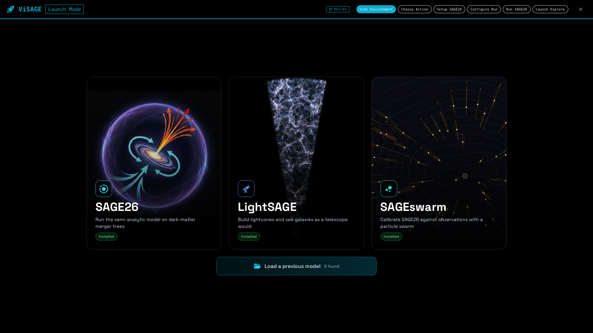
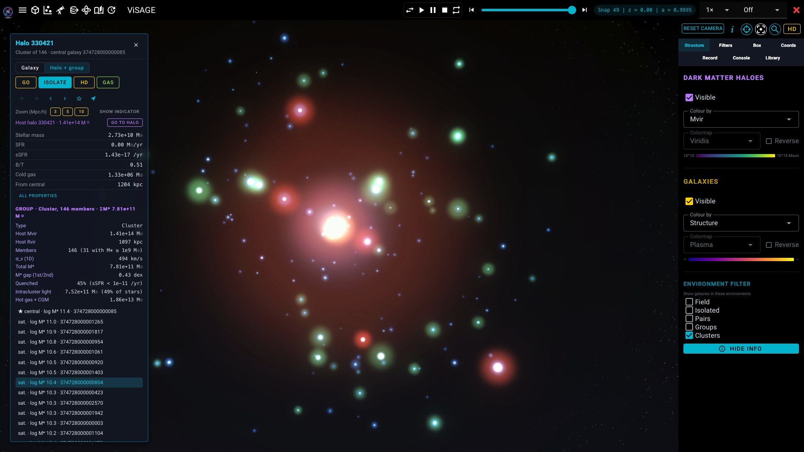
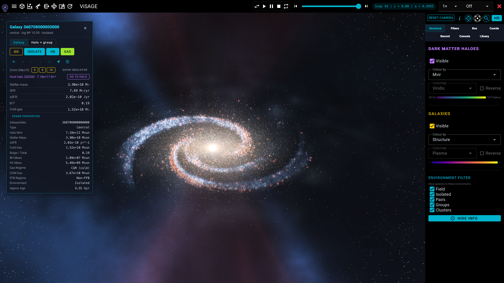
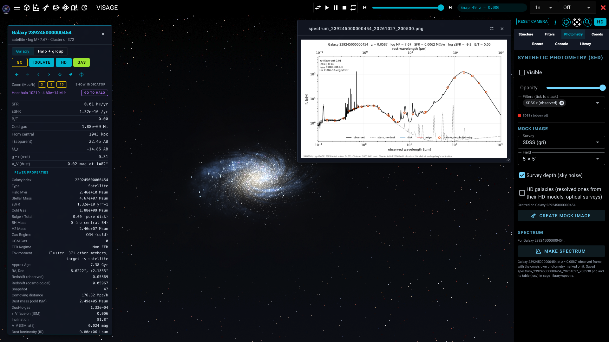

<p align="center">
  
</p>

# SAGE26 — Semi-Analytic Galaxy Evolution

[](https://sage26.readthedocs.io/en/latest/)

SAGE26 is a C99 semi-analytic code for modelling galaxy formation in a cosmological
context. It is a major update to [Croton et al. (2016)](https://arxiv.org/abs/1601.04709),
adding a two-regime CGM model, FIRE stellar feedback, feedback-free burst (FFB) galaxies,
multiple H2-based star formation prescriptions, and extended bulge/ICS tracking. Two
optional layers add detail on top of these recipes: radially resolved discs with
angular-momentum tracking (`DarkSAGEMode`, after DarkSage) and dust (`DustySAGEMode`,
after Dusty-SAGE).

SAGE reads N-body merger trees, evolves galaxies through cosmic time using
semi-analytic prescriptions, and writes galaxy catalogues in HDF5 or binary format.
It runs on any simulation whose trees are in a supported format and contain a minimum set
of halo properties. Test trees for the
[Mini-Millennium Simulation](http://arxiv.org/abs/astro-ph/0504097) are provided.

---

## What is new in SAGE26

| Feature | Parameter | Reference |
|---------|-----------|-----------|
| Two-regime CGM model with self-regulating precipitation | `CGMrecipeOn` | Dekel & Birnboim (2006), Voit (2015) |
| FIRE stellar feedback | `FIREmodeOn` | Muratov et al. (2015) |
| Feedback-free burst galaxies | `EnhancedStarFormationOn` | Li et al. (2024), Boylan-Kolchin (2025) |
| 8 star formation prescriptions, 6 of them H2-based | `SFprescription` | BR06, S25, KD12, KMT09, K13, GD14 |
| Separate merger/instability bulge tracking | `BulgeSizeOn` | Tonini et al. (2016) |
| ICS assembly tracking | always on | — |
| Full star formation history arrays | `SaveFullSFH` | — |
| Full stellar metallicity history arrays | `SaveFullMH` | — |
| Concentration | `ConcentrationOn` | Ishiyama+21 lookup table, Vmax/Vvir, Vmax/Vvir with subhalo infall freeze, Dutton & Macciò (2014) |
| Radially resolved discs in 30 specific-angular-momentum annuli, gas and stellar spins | `DarkSAGEMode` | Stevens, Croton & Mutch (2016); Stevens et al. (2024) |
| Dust: delayed AGB/SNII production, grain growth, SN destruction, sputtering | `DustySAGEMode` | Triani et al. (2020) |
| ConsistentTrees, Genesis, Gadget-4 tree readers | `TreeType` | — |
| HDF5 output + libsage.so for Python/PSO | `OutputFormat` | — |

---

## Discs and dust on top of SAGE26

SAGE26 can carry two extra layers of detail without changing any of its results:

```
DarkSAGEMode                1   %0: switch off; 1: SAGE26 bulk recipes shared over 30 radial annuli, SAGE26's DiskScaleRadius (output identical to SAGE26); 2: as 1, DiskScaleRadius from the annuli; 3: as 2, SF law evaluated per annulus
DustySAGEMode               1   %0: switch off; 1: passive dust within SAGE26's metals; 2: Dusty-SAGE delayed yields and dust
```

With this combination every SAGE26 output is identical to a run with both modes off
(verified field by field), and the extra detail is written alongside:

- **Discs in annuli** (`DarkSAGEMode 1`): each galaxy's cold gas, gas metals, stellar
  disc, stellar metals, H2, HI and star formation (and dust, with `DustySAGEMode` on) in
  30 annuli of specific angular momentum, mapped to radii through the galaxy's rotation curve (`DiscRadii`, `DiscVcirc`),
  plus gas and stellar spin vectors, stellar velocity dispersions, disc scale and half-mass
  radii. The annuli sum to SAGE26's galaxy totals.
- **Dust** (`DustySAGEMode 1`): dust in the cold, hot, CGM and ejected gas, made by AGB
  stars and SNII from delayed yields, grown in molecular gas, destroyed by supernovae and
  sputtered in hot gas, with formation, growth and destruction rates. It sits within
  SAGE26's metals and moves with the gas.

The higher modes go further and do change SAGE26's results: `DarkSAGEMode 2` lets the disc
radius come from the annuli, `DarkSAGEMode 3` also forms stars annulus by annulus, and
`DustySAGEMode 2` replaces SAGE26's metal production with the delayed yields. The modes
work together and with every other option. Details: [`docs/physics/darksage_and_dust.md`](docs/physics/darksage_and_dust.md);
outputs: [`docs/outputs.md`](docs/outputs.md).

---

## Install

### Dependencies

| Package | Required | Notes |
|---------|----------|-------|
| C99 compiler (gcc or clang) | Yes | |
| [GSL](https://www.gnu.org/software/gsl/) | Yes | required for tests |
| [HDF5](https://www.hdfgroup.org/) | Optional | HDF5 tree reading and output |
| MPI | Optional | parallel execution |

### Build

```bash
git clone https://github.com/MBradley1985/SAGE26.git
cd SAGE26
make                   # default build -- produces ./sage and libsage.so
make USE-MPI=          # serial build (no mpicc needed)
make USE-HDF5=         # build without HDF5 tree reading and output
make MEM-CHECK=yes     # address/UB sanitizers for debugging (gcc only)
make clean             # remove all build artefacts
```

**MPI and HDF5 are on by default** (`USE-MPI` and `USE-HDF5` at the top of the
Makefile), so a plain `make` needs `mpicc` and the HDF5 libraries on your path.
Set a switch to empty to turn it off, as above -- `USE-MPI=yes` is already the
default and does nothing. The regression baseline requires the serial build.

---

## Quickstart

```bash
./first_run.sh                          # create output dirs, download Mini-Millennium trees
./sage input/millennium.par             # run the model (serial)
mpirun -np 4 ./sage input/millennium.par  # run in parallel
python plotting/allresults-local.py     # z=0 diagnostic plots
python plotting/allresults-history.py   # multi-redshift diagnostics
```

Full details on the parameter file format, output format, and all physics switches are in
[`docs/parameters.md`](docs/parameters.md).

---

## Physics options

Every switch below is parsed by [`src/core_read_parameter_file.c`](src/core_read_parameter_file.c).
Full descriptions, defaults, and the model-parameter (non-switch) list are in
[`docs/parameters.md`](docs/parameters.md).

### Star formation (`SFprescription`)

| Value | Prescription |
|-------|-------------|
| 0 | Croton et al. (2006) original |
| 1 | Blitz & Rosolowsky (2006) H2 |
| 2 | Somerville et al. (2025) SFR |
| 3 | Somerville et al. (2025) SFR + H2 |
| 4 | Krumholz & Dekel (2012) |
| 5 | Krumholz, McKee & Tumlinson (2009) |
| 6 | Krumholz (2013) |
| 7 | Gnedin & Draine (2014) |

### AGN feedback (`AGNrecipeOn`)

| Value | Mode |
|-------|------|
| 0 | Off |
| 1 | Empirical (Croton+2016 radio mode) |
| 2 | Bondi-Hoyle accretion |
| 3 | Cold-cloud accretion |

### Supernova feedback (`SupernovaRecipeOn`)

| Value | Mode |
|-------|------|
| 0 | Off |
| 1 | Croton+2016 reheating/ejection |

### Reionization (`ReionizationOn`)

| Value | Mode |
|-------|------|
| 0 | Off |
| 1 | Kravtsov+2004 analytic suppression of infall |

### Disk instability (`DiskInstabilityOn`)

| Value | Mode |
|-------|------|
| 0 | Off |
| 1 | Toomre criterion drives bulge growth, instability starbursts, BH growth |

### Two-regime CGM model (`CGMrecipeOn`)

Galaxies below the Dekel & Birnboim (2006) shock mass are placed in Regime 0 (CGM /
precipitation regime); those above are in Regime 1 (hot-halo / classical cooling regime).
Each regime uses a dedicated cooling recipe.

| Parameter | Values | Effect |
|-----------|--------|--------|
| `CGMrecipeOn` | 0/1 | 0=off (classical C16 cooling only); 1=on, following Carr et al. (2023). |


### Adaptive time integration (`SubstepResolution`)

The snapshot interval is integrated with a substep count that scales with
`deltaT / t_dyn`, so high-redshift snapshots spanning several dynamical times
are resolved with more substeps (bounded by a `STEPS` floor and `MAX_STEPS`
cap) rather than a fixed count.

| Parameter | Values | Effect |
|-----------|--------|--------|
| `SubstepResolution` | double | Runtime multiplier on both the adaptive-substep floor and cap; default 1.0. Sweep for convergence / N-invariance testing without recompiling |

### FIRE stellar feedback (`FIREmodeOn`)

| Value | Mode |
|-------|------|
| 0 | Off |
| 1 | Muratov+2015 FIRE mass loading |

### Feedback-free burst galaxies (`EnhancedStarFormationOn`)

| Value | Mode |
|-------|------|
| 0 | Off |
| 1 | Li+2024 mass threshold with their eq. 3 sigmoid |
| 2 | Boylan-Kolchin+2025 acceleration threshold, log-normal concentration scatter |

### Halo concentration (`ConcentrationOn`)

| Value | Method |
|-------|--------|
| 0 | Off |
| 1 | Ishiyama+2021 lookup table |
| 2 | V_max / V_vir from the simulation |
| 3 | V_max / V_vir with subhalo infall freeze for satellites |
| 4 | Dutton & Macciò (2014) with the Di Cintio et al. (2014) baryonic factor (DarkSage) |

### H2 star formation (auxiliary switches)

| Parameter | Values | Effect |
|-----------|--------|--------|
| `H2DiskAreaOption` | 0–2 | Disk area for H2 surface density: 0=π r_s²; 1=π (3 r_s)²; 2=2π r_s² |
| `H2RadialIntegrationOn` | 0/1 | Radial ring integration for H2 fraction (slower, more accurate) |
| `H2RadialNBins` | int | Number of radial bins for ring integration |
| `H2DepletionMode` | 0-5 | 0 off; 1-5: SFR = M_mol / t_dep (no SfrEfficiency), with t_dep: 1 = 1 Gyr (Lagos+18); 2 KMT09 eq. 10; 3 Krumholz 2013 eqs. 15-16; 4 KDM12 eqs. 4, 8, 9; 5 DarkSage, 2.30 Gyr |

### Radially resolved discs (`DarkSAGEMode`)

Follows DarkSage (Stevens, Croton & Mutch 2016; Stevens et al. 2024): 30 annuli in
specific angular momentum, mapped to radii through each galaxy's rotation curve; cooling
and merging gas placed by its angular momentum; gas and stellar disc spins, precession and
counter-rotation. SAGE26 keeps deciding how much gas cools, forms stars, is reheated,
becomes unstable or bursts.

| Value | Mode |
|-------|------|
| 0 | Off |
| 1 | SAGE26's recipes shared over the annuli, with SAGE26's disc radius: output identical to SAGE26, the annuli as added detail |
| 2 | As 1, but the disc radius is measured from the annuli (smaller massive discs, less efficient star formation in gas-rich small discs) |
| 3 | As 2, and the star-formation law is evaluated on each annulus's own surface density |

`H2DepletionMode` 2-4 need `H2RadialIntegrationOn = 1` in modes 0-2; mode 3 uses the
annuli instead.

### Dust (`DustySAGEMode`)

Follows Dusty-SAGE (Triani et al. 2020), with its known source bugs fixed (listed in
`docs/physics/darksage_and_dust.md`).

| Value | Mode |
|-------|------|
| 0 | Off |
| 1 | Passive dust inside SAGE26's metals; every non-dust output identical to 0 |
| 2 | Dusty-SAGE delayed yields replace SAGE26's metal production; dust held outside the metals |

| Parameter | Values | Effect |
|-----------|--------|--------|
| `DustSNIIYields` | 0/1 | SNII yields: 0 = Woosley & Weaver (1995); 1 = Nomoto et al. (2006) |
| `DustSNIaYields` | 0/1 | SNIa yields: 0 = Iwamoto et al. (1999); 1 = Seitenzahl et al. (2013) |
| `DustBinaryFraction` | double | Fraction of 3-16 Msun stars in SNIa binaries (default 0.1) |

Grain growth needs H2, so it is off with `SFprescription` 0 or 2. With `DarkSAGEMode`
on, the dust is carried by the annuli (`DiscDust`).

### Mergers and ICS tracking

| Parameter | Values | Effect |
|-----------|--------|--------|
| `MergerTimeFactor` | double | Scales the dynamical-friction merger timescale, and with it the split of accreted stellar mass between the ICS and the BCG |

ICS assembly tracking (`ICS_disrupt`, `ICS_accrete`, `ICS_sum_mt`) is always on.

### Output

| Parameter | Values | Effect |
|-----------|--------|--------|
| `OutputFormat` | string | `sage_hdf5`, `sage_binary`, or `lhalo_binary_output` to convert the input trees to lhalo-binary instead of running the model |
| `SaveFullSFH` | 0/1 | Track per-snapshot SFR history arrays |
| `SaveFullMH` | 0/1 | Track the metal mass in the stars of each SFH bin (needs `SaveFullSFH = 1`) |
| `NumOutputs` | int | Number of snapshot outputs; `-1` = all snapshots |

`DarkSAGEMode` and `DustySAGEMode` add their own datasets (annulus arrays, spins, dust
reservoirs and rates) to the HDF5 output only when they are on; files with both off are
unchanged. See [`docs/outputs.md`](docs/outputs.md).

### Supported tree formats (`TreeType`)

`lhalo_binary`, `lhalo_hdf5`, `consistent_trees_ascii`, `consistent_trees_hdf5`,
`genesis_hdf5`, `gadget4_hdf5`

---

## Tests

```bash
cd tests && make test               # build and run all suites
cd tests && make test_conservation  # conservation tests only (fastest)
cd tests && make quick              # single fastest check
bash tests/run_integration_tests.sh # full integration test (slower)
bash tests/darksage_mode_checks.sh  # DarkSAGEMode/DustySAGEMode checks on full Millennium runs
```

`darksage_mode_checks.sh` checks that `DarkSAGEMode 1` and `DustySAGEMode 1` reproduce
SAGE26 exactly and that the annuli sum to the galaxy totals. Its runs take about 30 GB
while it works and are deleted when it finishes.

The regression baseline checks that every one of the 5252 output datasets is
bit-identical to the committed reference. It needs the serial build, and note
that `make tests` relinks `sage` through its `$(EXEC)` dependency, so build in
this order:

```bash
make clean && make USE-MPI=      # serial build
bash tests/regression_baseline.sh
```

After an intentional physics change, recapture the baseline in the same commit
and say so in the message (see
[docs/developer/STYLE_COMMITS.md](docs/developer/STYLE_COMMITS.md)):

```bash
python3 tests/regression_baseline.py capture input/millennium.par
```

See [docs/developer/REGRESSION_BASELINE.md](docs/developer/REGRESSION_BASELINE.md)
for the full policy.

---

## Parameter calibration (SAGE-PSO)

Automated parameter calibration via Particle Swarm Optimization is available as a separate
package: [SAGE-PSO](https://github.com/MBradley1985/SAGE-PSO). It drives `libsage.so` to
evaluate parameter samples against observational constraints (stellar mass functions,
star formation rates, etc.) and supports machine-learning emulators to accelerate
optimization.

---

## ViSAGE

Everything in one place, plus data visualisation. Give it a try: https://github.com/MBradley1985/ViSAGE
<p align="center">
  
  
  
  
</p>

---

## Citation

If you use SAGE26 in a publication, please cite:

```bibtex
@article{bradley2026a,
  title = {SAGE26 Paper I: Modelling the Baryon Cycle from Cosmic Dawn to the Present Day},
  author = {Bradley, Michael and Croton, Darren J. and Paun, Robert A. Mostoghiu and Chowdhury, Dhruba Dutta and Willingham, Jayde},
  year = 2026,
  journal = {The Astrophysical Journal Supplement Series},
  publisher = {(In prep.)}
}
```


and the original SAGE paper:

```bibtex
@article{croton2016sage,
  author  = {Croton, D.~J. and Stevens, A.~R.~H. and Tonini, C. and
             Garel, T. and Bernyk, M. and Bibiano, A. and Hodkinson, L. and
             Mutch, S.~J. and Poole, G.~B. and Shattow, G.~M.},
  title   = {Semi-Analytic Galaxy Evolution (SAGE): Model Calibration and Basic Results},
  journal = {ApJS},
  year    = {2016},
  volume  = {222},
  pages   = {22},
  doi     = {10.3847/0067-0049/222/2/22},
  eprint  = {1601.04709},
}
```

Original SAGE is also available on [ascl.net](http://ascl.net/1601.006).

If you use `DarkSAGEMode`, please also cite the DarkSage paper,
[Stevens, Croton & Mutch (2016), MNRAS, 461, 859](http://adsabs.harvard.edu/abs/2016MNRAS.461..859S).
If you use `DustySAGEMode`, please also cite Dusty-SAGE:

```bibtex
@article{triani2020dust,
  author  = {Triani, Dian P. and Sinha, Manodeep and Croton, Darren J. and
             Pacifici, Camilla and Dwek, Eli},
  title   = {The origin of dust in galaxies across cosmic time},
  journal = {MNRAS},
  year    = {2020},
  volume  = {493},
  pages   = {2490-2505},
  doi     = {10.1093/mnras/staa446},
  eprint  = {2002.05343},
}
```

---

## Links

- [Documentation](https://sage26.readthedocs.io/en/latest/)
- [Parameter reference](https://sage26.readthedocs.io/en/latest/parameters.html)
- [Developer guide](docs/developer/README.md)
- [Changelog](CHANGELOG.md)
- [Contributing](CONTRIBUTING.md)
- [SAGE-PSO](https://github.com/MBradley1985/SAGE-PSO) — automated parameter calibration

---

## Authors and maintainers

- Michael Bradley ([@MBradley1985](https://github.com/MBradley1985)) — mbradley@swin.edu.au
- Darren Croton ([@darrencroton](https://github.com/darrencroton))

Questions and comments welcome via GitHub Issues or email.

---

## License

MIT — see [LICENSE](LICENSE).

---

## Acknowledgement

Claude Code (Anthropic) was used during development for documentation and style-guide work, linting, code-error fixes, building the test suite, and some code restructuring. All model design, physics choices, and results remain the authors' own, and all such changes were reviewed and tested before inclusion.
